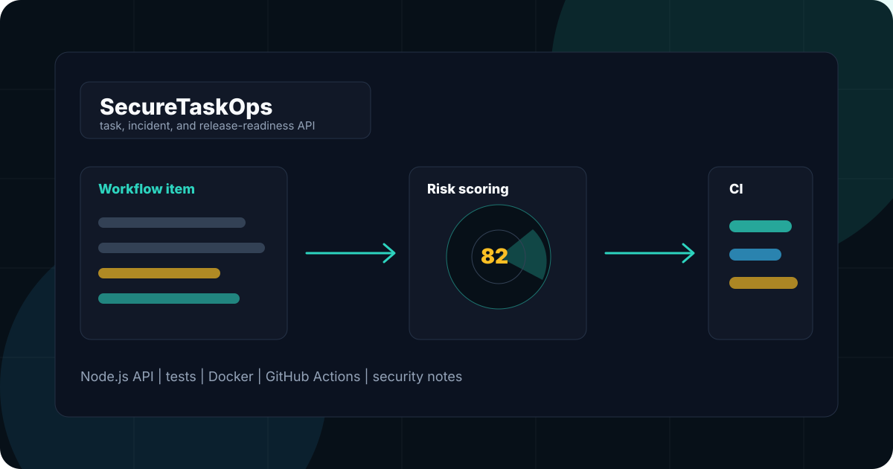
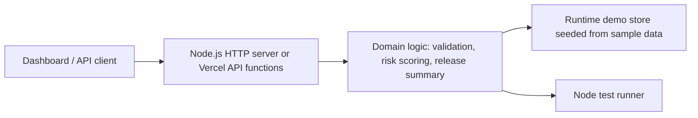

# SecureTaskOps Workflow Platform

Security-aware workflow dashboard and API for tracking release readiness, blockers, risk signals and security-sensitive work.

Live app: https://securetaskops-workflow-platform.vercel.app/

> Status: deployed product demo. It includes a working dashboard, API routes, task creation, filtering, release-readiness summary, tests, Docker support and CI. Demo data may reset when the serverless runtime refreshes.



## Problem

Small teams often track tasks, incidents, blockers and release readiness across scattered notes or manual dashboards. That makes it harder to see which work is blocked, which changes are security-sensitive, and whether a release needs attention before shipping.

## Solution

SecureTaskOps exposes a dashboard and Node.js API that model workflow items, score delivery/security risk, filter tasks, create new items, and summarize release readiness. The goal is to make release risk visible before work ships.

## Tech Stack

- Node.js native HTTP server
- Vercel serverless API routes
- Static dashboard UI
- JavaScript modules
- Node test runner
- Docker and Docker Compose
- GitHub Actions CI

## Features

- Browser dashboard for release signal, task queue, filters and item creation
- `GET /health` local health check
- `GET /api/health` deployed health check
- `GET /api/tasks` task list with `status`, `owner`, and `severity` filters
- `POST /api/tasks` workflow item creation with validation
- `GET /api/release-readiness` release summary and status signal
- Risk scoring based on severity, blocked work, due date and security-sensitive changes
- Tests for validation, filtering, risk scoring and release readiness
- Dockerfile, Docker Compose, `.env.example`, CI workflow, changelog and security notes

## Architecture



Main modules:

- `public/index.html`, `public/app.css`, and `public/app.js` provide the dashboard.
- `api/*.js` provides Vercel serverless endpoints.
- `src/server.js` handles local HTTP routing, JSON responses and static dashboard files.
- `src/domain.js` contains validation, risk scoring, filtering and release summary logic.
- `src/sample-data.js` provides deterministic sample workflow items.
- `test/domain.test.js` covers core logic and edge cases.

## Local Setup

```bash
git clone https://github.com/Assembler-Fourier/securetaskops-workflow-platform.git
cd securetaskops-workflow-platform
npm install
npm test
npm start
```

Open the dashboard at:

```bash
http://localhost:3000
```

## API Examples

Health check:

```bash
curl http://localhost:3000/health
curl http://localhost:3000/api/health
```

List high-severity tasks:

```bash
curl "http://localhost:3000/api/tasks?severity=high"
```

Create a workflow item:

```bash
curl -X POST http://localhost:3000/api/tasks \
  -H "content-type: application/json" \
  -d '{"title":"Review auth callback validation","owner":"Uzair","status":"blocked","severity":"high","securitySensitive":true,"dueDate":"2026-07-06"}'
```

Release readiness:

```bash
curl http://localhost:3000/api/release-readiness
```

## Testing

```bash
npm run check
npm test
```

Covered:

- Required-field validation
- Risk scoring boundaries
- Blocked and security-sensitive risk reasons
- Query-style filtering
- Release-readiness summary logic

Not covered yet:

- Browser UI tests
- Persistent database integration
- Authentication and role-based authorization

## Docker

```bash
docker compose up --build
```

Then open `http://localhost:3000`.

## CI/CD

The repository includes GitHub Actions for syntax checks and tests on pushes and pull requests to `main`.

## Security Notes

- Request JSON is validated before workflow items are created.
- `.env.example` documents configuration without committing secrets.
- The deployed demo does not yet include authentication, authorization, rate limiting, persistent storage, or audit logging.
- Future production hardening should add auth, RBAC, request size limits, schema validation, database migrations, structured logs, and deployment secrets management.

## Tradeoffs

- Uses runtime demo data to keep setup fast and public.
- Uses Node's native HTTP server to keep domain logic visible.
- Keeps the scoring model explainable instead of pretending it is a complete compliance engine.

## Known Limitations

- Demo data may reset when the serverless instance refreshes.
- No database persistence yet.
- No user authentication yet.
- Risk scoring is a simple transparent heuristic, not a compliance model.

## Future Improvements

- Add PostgreSQL persistence and migrations.
- Add Fastify or Express route layer with schema validation.
- Add authentication and role-based access control.
- Add HTTP route tests and coverage reporting.
- Add browser smoke tests for the dashboard.
- Add audit log export and role-specific views.

## What This Demonstrates

This project demonstrates backend API design, a deployed dashboard, modular domain logic, validation, testable risk scoring, release-readiness modeling, Docker setup, CI workflow, security-aware thinking, and honest technical documentation.
