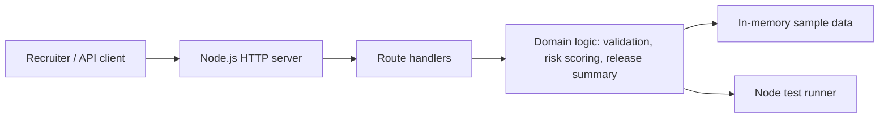

# SecureTaskOps Workflow Platform

Security-aware task, incident, and release-readiness workflow API built as a focused flagship portfolio project for full-stack/backend software engineering roles.

> Honest status: this is a current portfolio build, not a production SaaS claim. It is designed to be runnable, testable, documented, and easy for a recruiter or engineering manager to review.


## Problem

Small teams often track tasks, incidents, blockers, and release readiness across scattered notes or manual dashboards. That makes it harder to see which work is blocked, which changes are security-sensitive, and whether a release needs attention before shipping.

## Solution

SecureTaskOps exposes a small Node.js API that models workflow items, scores delivery/security risk, filters tasks, and summarizes release readiness. The goal is to show practical backend structure, testable business logic, Docker setup, CI, and clear documentation.

## Tech Stack

- Node.js native HTTP server
- JavaScript modules
- Node test runner
- Docker and Docker Compose
- GitHub Actions CI

## Features

- `GET /health` service health check
- `GET /api/tasks` task list with `status`, `owner`, and `severity` filters
- `POST /api/tasks` workflow item creation with validation
- `GET /api/release-readiness` release summary and status signal
- Risk scoring based on severity, blocked work, due date, and security-sensitive changes
- Tests for validation, filtering, risk scoring, and release readiness
- Dockerfile, Docker Compose, `.env.example`, CI workflow, changelog, and security notes

## Architecture



Main modules:

- `src/server.js` handles HTTP routing and JSON responses.
- `src/domain.js` contains validation, risk scoring, filtering, and release summary logic.
- `src/sample-data.js` provides deterministic sample workflow items.
- `test/domain.test.js` covers core logic and edge cases.

## Local Setup

```bash
git clone https://github.com/Assembler-Fourier/securetaskops-workflow-platform.git
cd securetaskops-workflow-platform
npm install
npm test
npm start
```

The API runs on `http://localhost:3000` by default.

## API Examples

Health check:

```bash
curl http://localhost:3000/health
```

List high-severity tasks:

```bash
curl "http://localhost:3000/api/tasks?severity=high"
```

Create a workflow item:

```bash
curl -X POST http://localhost:3000/api/tasks \
  -H "content-type: application/json" \
  -d '{"title":"Review auth callback validation","owner":"Uzair","status":"blocked","severity":"high","securitySensitive":true,"dueDate":"2026-07-06"}'
```

Release readiness:

```bash
curl http://localhost:3000/api/release-readiness
```

## Testing

```bash
npm run check
npm test
```

Covered:

- Required-field validation
- Risk scoring boundaries
- Blocked and security-sensitive risk reasons
- Query-style filtering
- Release-readiness summary logic

Not covered yet:

- End-to-end HTTP route tests
- Persistent database integration
- Authentication and role-based authorization

## Docker

```bash
docker compose up --build
```

Then open `http://localhost:3000/health`.

## CI/CD

The repository includes GitHub Actions for syntax checks and tests on pushes and pull requests to `main`.

## Security Notes

- Request JSON is validated before workflow items are created.
- `.env.example` documents configuration without committing secrets.
- This prototype does not yet include authentication, authorization, rate limiting, persistent storage, or audit logging.
- Future production hardening should add auth, RBAC, request size limits, schema validation, database migrations, structured logs, and deployment secrets management.

## Tradeoffs

- Uses in-memory sample data to keep reviewer setup fast.
- Uses Node's native HTTP server to avoid hiding domain logic behind framework boilerplate.
- Keeps the scoring model explainable instead of pretending it is a complete risk engine.

## Known Limitations

- No database persistence yet.
- No user authentication yet.
- No live hosted API yet.
- No frontend dashboard yet.
- Risk scoring is a simple transparent heuristic, not a compliance model.

## Future Improvements

- Add PostgreSQL persistence and migrations.
- Add Fastify or Express route layer with schema validation.
- Add authentication and role-based access control.
- Add HTTP route tests and coverage reporting.
- Add a Next.js dashboard for release and incident review.
- Deploy a live demo with documented environment configuration.

## What This Demonstrates

This project demonstrates backend API design, modular domain logic, validation, testable risk scoring, release-readiness modeling, Docker setup, CI workflow, security-aware thinking, and honest technical documentation.
